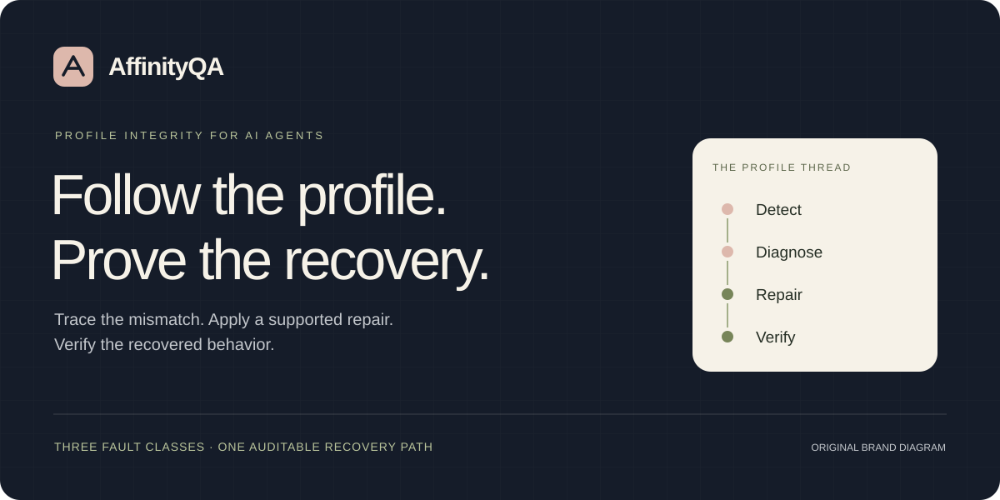
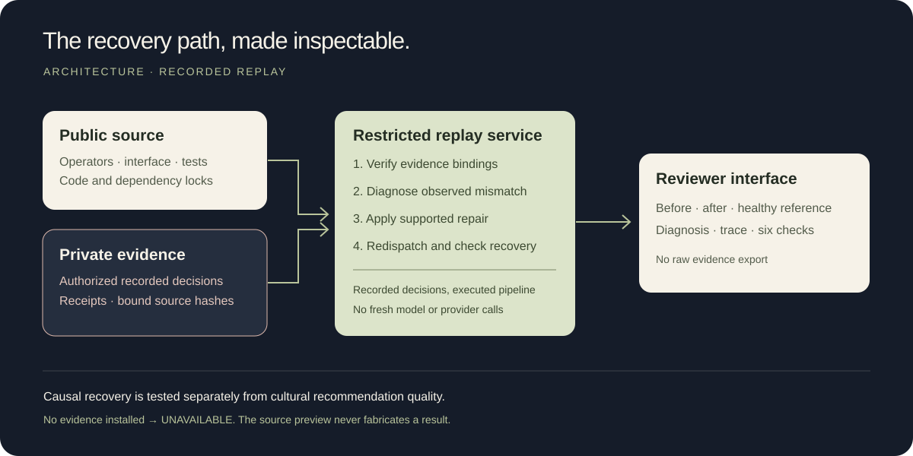

# AffinityQA

**Follow the profile. Prove the recovery.**

AffinityQA helps engineers catch personalization incidents that ordinary output checks miss. It follows an explicit musical interest through Qloo context, an agent's request routing and its cache, diagnoses the supported fault, applies a repair and checks the recovery against a healthy reference.

[Open the hosted workspace](https://affinityqa-review.onrender.com/demo) · [Judge walkthrough](docs/DEMO-GUIDE.md) · [Engineering review](docs/CLOUD-ENGINEERING-REVIEW.md) · [Acceptance record](docs/JUDGE-ACCEPTANCE.md)

## Review the product

| Path | What you can inspect | Evidence boundary |
| --- | --- | --- |
| **Recorded repair** | Choose an incident; follow Detect, Diagnose, Repair and Verify; compare the requested profile, consumed context and healthy output | Replays a genuine captured experiment; zero new Qloo/model calls |
| **New individual case** | Open a private visitor session; review musical interests and film preferences; confirm artist identities; inspect results and the selected verification | Uses the owner's providers when enabled; review the displayed plan and limits before starting |

The hosted workspace needs a browser. Judges do not install Docker, run a local model or supply API keys. Start with the recorded repair; the [walkthrough](docs/DEMO-GUIDE.md) gives the short click path and the separate fresh-case path.

## The integration problem

A plausible movie list can belong to the wrong taste profile. AffinityQA makes the profile chain inspectable and checks three controlled incidents:

| Incident | Supported diagnosis | Repair |
| --- | --- | --- |
| A cache key omits the profile | `CACHE_OMITS_PROFILE` | Bind the cache to profile identity |
| An old profile reaches the agent | `STALE_PROFILE` | Restore the requested profile |
| Qloo context belongs to another profile | `WRONG_TOOL_PROFILE` | Bind the tool context to the request |

Repairs affect the supported adapter and session/cache configuration. They are checked against healthy behavior and legitimate cache reuse.

Qloo supplies real cross-domain movie context for musical interests. That context is consumed by the tested agent, so its identity and routing boundary can be tested. Movie preferences remain explicit user inputs; Qloo affinities are not individual ground truth.

## Verified engineering and live status

**Status checked on 13 October 2026.** The live service runs [`250aac1`](https://github.com/seypherWork/affinityqa/commit/250aac1258535db593db644747a5659003fced82). [PR #1](https://github.com/seypherWork/affinityqa/pull/1), source [`f2a7808`](https://github.com/seypherWork/affinityqa/commit/f2a780877322d8e788bf55100ae9d600bf3e25e5), fixes interrupted progress polling and the duplicate-UUID artist-search stop with a source-bound discovery-v3 successor. Its deployment and live v3 acceptance are pending at this snapshot.

[CI run 38323716705](https://github.com/seypherWork/affinityqa/actions/runs/38323716705) passed **479 Python tests on Windows and 479 on Ubuntu**, plus type checking and production export. Three browser regressions passed on Linux: desktop recovery, mobile viewport recovery and a complete new-case journey with fake providers. The browser journey checks the verification HTTP response and session restoration; native browser-file download remains a separate acceptance item.

The retained live case `20261012T230633Z-8a5793a9` stopped PARTIAL after two Qloo searches and zero model calls. Original-source inspection established the duplicate-ID stop; the v3 projection processes those retained responses without changing them. The historical partial case and its consumed admission remain intact. Passing synthetic tests does not make that case COMPLETE.

Recorded causal integrity, remote backend comparability and cultural recommendation quality have separate gates. Remote causal attribution remains **INCONCLUSIVE**; cultural quality is **NOT_VALIDATED**, with **zero verified human participants**. Historical quality failures retain their original scores. These limits describe the evaluated agent and evidence; the final jury-readiness record remains open until the live journey and usable judge access are verified.

## Run the source checks

CI used Python **3.13.16 on Windows**, **3.12.14 on Ubuntu 24.04**, Node.js **24.19.0** and pnpm **11.25.0**.

**Windows · PowerShell**

~~~powershell
& "C:\path\to\python.exe" -m venv .venv
.\.venv\Scripts\python.exe -m pip install -r requirements-backend.lock.txt
.\.venv\Scripts\python.exe -m unittest discover -s tests -v
~~~

Use your installed Python 3.13 executable in the first command.

**Linux**

~~~bash
python3.12 -m venv .venv
.venv/bin/python -m pip install -r requirements-backend.lock.txt
.venv/bin/python -m unittest discover -s tests -v
~~~

**Web build · either platform**

~~~text
cd web
npx --yes pnpm@11.25.0 install --frozen-lockfile --ignore-scripts
npx --yes pnpm@11.25.0 typecheck
npx --yes pnpm@11.25.0 build
cd ..
~~~

Dependency installation requires registry access. [Full source setup](docs/PUBLIC-CODE-QUICKSTART.md) covers the local preview. Without matching owner-supplied recorded evidence, that preview reports UNAVAILABLE; public source contains no fabricated replacement results, provider captures or credentials. The hosted link is the judge entry point.

For synthetic browser regressions on Linux, after the web build:

~~~text
cd web
npx --yes pnpm@11.25.0 exec playwright install --with-deps chromium
npx --yes pnpm@11.25.0 test:recovery
npx --yes pnpm@11.25.0 test:case-journey
~~~

## Project map

| Area | Contents |
| --- | --- |
| `src/affinityqa/` | Capture protocols, diagnostics, supported repairs, independent file verifiers and retained case store |
| `web/` | Jury workspace and private review interface |
| `tests/` | Synthetic contract, integrity and failure regressions; browser scenarios |
| `scripts/` | Source packaging, server entry points, verification and read-only diagnosis |
| `deployment/` | Render build/start instructions and explicit owner configuration |
| `docs/` | Walkthrough, acceptance, protocol contracts and provenance |

Existing storage needs the reviewed, stopped-store continuation in [PUBLIC-NEW-CASES.md](docs/PUBLIC-NEW-CASES.md) when manager sources change. Preserve sessions, receipts, original capture paths and consumed admissions; do not reset them to make a deployment pass.

## License and data

Original AffinityQA code is **MIT licensed**; see [LICENSE](LICENSE). Qloo data, model decisions, models and third-party assets retain their own terms. Raw captures and provider credentials remain private. [Licensing scope](docs/LICENSING.md) · [Asset provenance](docs/ASSET-PROVENANCE.md)
