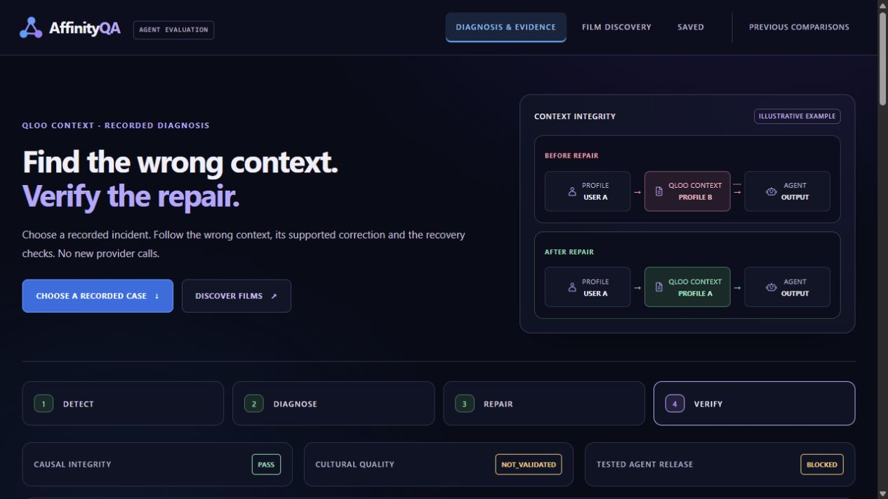
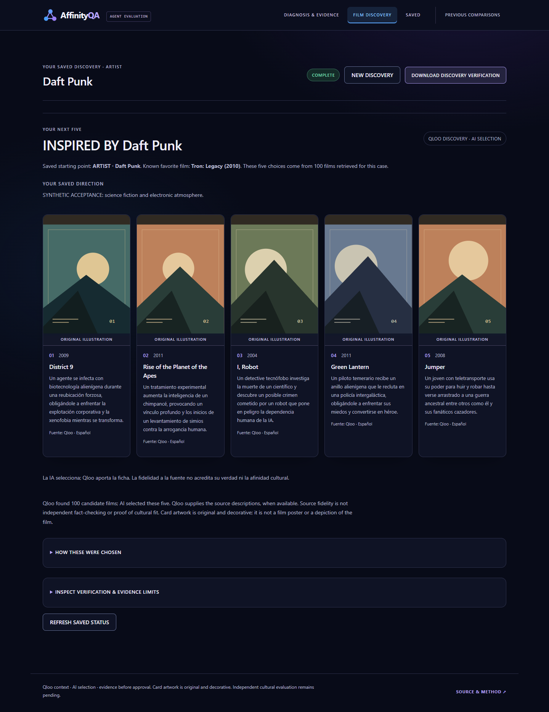

# AffinityQA

**Find the wrong context. Verify the repair.**

A Qloo-powered workbench for diagnosing personalization faults. Trace the
requested taste through Qloo context, the agent and its cache; apply one
supported correction and verify recovery. A companion discovery flow accepts
a film or artist and recommends five films from up to 100 Qloo candidates.

[Open the live app](https://affinityqa-review.onrender.com/demo#recorded) ·
[Judge walkthrough](docs/DEMO-GUIDE.md) ·
[Windows/Linux checks](https://github.com/seypherWork/affinityqa/actions/workflows/public-source-tests.yml) ·
[MIT license](LICENSE)



## The jury's shortest route

1. **DIAGNOSIS & EVIDENCE:** replay a recorded incident. Follow Detect → Diagnose →
   Repair → Verify, inspect the input/context mismatch and the recovery checks.
   This uses saved decisions and makes no new provider calls.
2. **FILM DISCOVERY:** enter a film or artist, review the plan and explicitly
   confirm its identity (including a film's year). Discover five films, inspect
   the source descriptions and original artwork, then download the verification.
3. **SAVED:** reopen the same visitor session and restore its cases without
   generating recommendations again.

The hosted application needs no installation, Docker, personal API key or
running creator PC. Shared Qloo/Groq Free capacity remains finite; follow
waiting/failure messages and do not repeat an uncertain send.
[Access and evidence boundaries](docs/DEMO-GUIDE.md).

## What Qloo contributes

| Supported incident | Diagnosis | Correction |
| --- | --- | --- |
| A cache key omits the profile | `CACHE_OMITS_PROFILE` | Include the profile in the cache key. |
| The agent receives an old profile | `STALE_PROFILE` | Restore the current requested profile. |
| Tool context belongs to someone else | `WRONG_TOOL_PROFILE` | Bind Qloo context to the requested profile. |

The verifier checks the saved tool response, consumed context, model input,
decision, healthy-reference recovery and legitimate cache reuse. A recorded
controlled comparison changes only the consumed Qloo context; it does not
establish improved human taste or compare Qloo with no Qloo. Supported repairs
address these integration faults, not arbitrary software.

## Discovery with traceable inputs



Qloo resolves identities and retrieves a case-specific film pool. Groq Free /
GPT-OSS 20B selects eligible indices; the server reconstructs canonical films.
The model does not invent plots or explanation prose. Descriptions are tied to
the saved source, or use an explicit missing-description fallback. All card
artwork is original decorative illustration, not a film poster.

The screenshot shows an actual local Daft Punk / *Tron: Legacy (2010)* trial
with expressly synthetic operator preferences. Recommendation completion is
separate from its failed automated download check; that trial is not claimed
as a completed download/restoration test. The retained case and original test
outcome were preserved. [Current technical review](docs/TECHNICAL-REVIEW-20261022.md).

Inputs may be films or artists; outputs are five **films**. Artist/song
recommendations, playback and exhaustive worldwide catalog coverage are not
implemented.

## Run the source checks

Use the installed Python version appropriate to your platform and the existing
dependency locks. These are synthetic engineering tests and need no API keys:

```text
python -m pip install -r requirements-backend.lock.txt
python -m pip install --require-hashes -r requirements-repeatable.lock.txt
python -m unittest discover -s tests -v
cd web
npx --yes pnpm@11.25.0 install --frozen-lockfile --ignore-scripts
npx --yes pnpm@11.25.0 typecheck
npx --yes pnpm@11.25.0 build
npx --yes pnpm@11.25.0 test:diagnostic-evidence
```

[Exact Windows/Linux setup and preview commands](docs/PUBLIC-CODE-QUICKSTART.md).
Private captures, credentials, model weights and owner case stores are excluded
from the public package. Original code is MIT licensed; third-party data and
models retain their own terms. [Asset provenance](docs/ASSET-PROVENANCE.md).

## Evaluation boundaries

The owner reports three real informal testers: himself (Eminem) and two friends
(Fast & Furious and Scream), with positive qualitative feedback. These are not
structured independent preference ratings. Broader cultural quality remains
**NOT_VALIDATED**; the retained historical remote causal campaign is
**INCONCLUSIVE**. Its evaluated-agent **BLOCKED** gate is separate from the
diagnostic application's availability.

<details>
<summary>Dated technical records and previous README snapshots</summary>


> **Human testing update — 20 October 2026:** Three real people (the creator and two friends) are reported to have tested the application, with positive qualitative feedback. See [current human testing evidence](docs/DEMO-GUIDE.md#informal-human-testing). Earlier technical records below did not collect structured human preference labels; they are not a current count of everyone who used the app.

# AffinityQA

**Follow the profile. Prove the recovery.**

A personalized agent can return plausible films for the wrong person.
AffinityQA follows an explicit taste profile through Qloo context, agent routing
and cache state, diagnoses three supported integration faults, applies the
corresponding repair and verifies recovery against healthy behavior.

[Try the recorded repair](https://affinityqa-review.onrender.com/demo#recorded) ·
[Discover films](https://affinityqa-review.onrender.com/demo#wide) ·
[Judge walkthrough](docs/DEMO-GUIDE.md) ·
[Dated acceptance](docs/JUDGE-ACCEPTANCE.md)

## Try it in your browser

No installation, Docker, local model or personal API key is needed. The hosted
application runs independently of the creator's PC.

| Path | What to do | What it proves |
| --- | --- | --- |
| **DIAGNOSIS & EVIDENCE** | Choose an incident, replay it, then inspect Detect → Diagnose → Repair → Verify. | The retained pipeline reproduces the supported routing/cache repair with saved real-model decisions. Zero new Qloo/model calls. |
| **FILM DISCOVERY** | Start with a film or artist, review the plan, explicitly confirm identities and discover five films. | A new Qloo candidate pool and one constrained Groq selection when shared capacity is available. |
| **SAVED** | Restore your private visitor session, inspect earlier cases and download their verification. | Existing results can be read without starting the work again. |

The [walkthrough](docs/DEMO-GUIDE.md) explains the shortest diagnostic opening,
identity confirmation, waiting states and recovery. **PREVIOUS COMPARISONS**
preserves earlier twenty-film tasks and their original evidence.

## Why Qloo belongs in the agent

Qloo resolves explicit film/artist identities and supplies cross-domain film
affinity context. That context is consumed by the agent and can be followed
through the request, tool response and cache. AffinityQA tests whether it stayed
bound to the requested taste, rather than checking only that the output is valid.

| Controlled incident | Diagnosis | Supported repair |
| --- | --- | --- |
| A cache key omits profile identity | `CACHE_OMITS_PROFILE` | Bind cached context to the profile. |
| An old profile reaches the agent | `STALE_PROFILE` | Restore the requested profile. |
| Tool context belongs to another profile | `WRONG_TOOL_PROFILE` | Bind Qloo context to the request. |

Repairs operate on the supported adapter/session/cache configuration. The
verifier checks the profile chain, healthy-reference recovery and legitimate
cache reuse. This is a diagnostic tool for teams building personalized agents;
it does not claim to repair arbitrary software.


## Film discovery with inspectable evidence

- Start with one film or artist. Artist mode can also include a known favorite
  film. Confirm the actual identity and, for films, the year.
- Discover five films from an actual Qloo pool of **up to 100 candidates per
  case**, rather than a permanent twenty-film output whitelist.
- An optional direction guides the model's selection within that pool. It is
  not sent as an undocumented Qloo free-text query.
- Groq Free / GPT-OSS 20B returns eligible indices only. The server reconstructs
  canonical film identities; the model supplies no plot or explanation prose.
- Descriptions reproduce that film's saved Qloo metadata, with language labels
  and a no-description fallback. Cards use labelled, original abstract artwork;
  no external posters load. Source fidelity does not establish film facts or taste.
- Ordinary screens hide internal codes. Technical identifiers remain in the
  selected verification download for audit.

Outputs are films, including when the input is an artist. Artist/song
recommendations and music playback are not current functions.
[Contract and boundaries](docs/WIDE-CINEMA-DISCOVERY.md).

## Verified hosted review — 20 October 2026

The last documented hosted walkthrough used **`1a6229e`**, also the revision
of [CI 39310299737](https://github.com/seypherWork/affinityqa/actions/runs/39310299737).
This is a dated observation, not a live status or a claim that later source
changes have been deployed. Keep source, CI and hosted evidence separate.

- All three supported recorded incidents passed in the hosted interface. The
  Qloo-context comparison exposes eight evidence checks, thirteen comparison
  checks and six recovery controls. It uses saved decisions, not new inference.
- Two additional hosted technical trials, **Scary Movie (2000)** and **Björk**,
  each retrieved 100 Qloo candidates and delivered five films with five loaded
  images. Total: six fresh Qloo requests and two Groq Free selections. Native
  verification downloads matched byte-for-byte after session restoration.
- All preexisting non-SQLite case files and historical rows were preserved;
  the two trials' normal counters and quota observations were reconciled.
- On the same unchanged source, the 20 October local Windows audit passed 774
  tests and 16 isolated desktop/mobile browser commands, plus typecheck/build.
  Those local tests used synthetic providers. The previous CI passed 774
  Windows and 770 Ubuntu tests; four Windows-only contracts were skipped on
  Ubuntu and passed on Windows. Windows CI browser steps were skipped.

These are operator technical trials with synthetic preferences, not independent
human preference participants or proof of cultural superiority. Groq remains
free with shared finite capacity. The [current judge walkthrough](docs/DEMO-GUIDE.md)
separates recorded repair, fresh discovery and clean-source synthetic review.

## Historical hosted acceptance — 18 October 2026

The hosted code was checked against `0faa96d`, with the existing service, cases,
model and hosting plan preserved. Groq remained free. This is dated acceptance,
not a guarantee of future provider availability.

| Evidence | Observed result | Boundary |
| --- | --- | --- |
| [CI 39163714448](https://github.com/seypherWork/affinityqa/actions/runs/39163714448) | 723 Windows tests passed; Ubuntu passed 719 and skipped four Windows-only tests, which passed on Windows. Types and production export passed on both. Ten Linux browser steps passed. | Synthetic providers; Windows CI browser steps were skipped. |
| Two real hosted discovery trials | Eminem and John Wick (2014), each with 100 candidates and five delivered films; six fresh Qloo requests and two Groq selections in total. | Operator-driven technical trials, not independent human preference participants. |
| Delivery and recovery | Both native verification downloads physically saved and checked; both cases restored on a fresh page in the same browser profile. Matching images and source descriptions were observed. | Read/download/restore is not another inference. |
| Recorded diagnosis | All three supported incidents passed their six replay controls. | Recorded decisions; zero new Qloo/model calls. |
| Preservation | Hosted history, original evidence and consumed work retained under explicit pre/post checks. | Permitted operational advances and the reviewed Eminem transition were checked separately. |

[Case details, file hashes and limits](docs/JUDGE-ACCEPTANCE.md).
In the earlier 19 October read-only observation, the repository still pointed
to that historical code and the hosted
health endpoint reported execution enabled without an admission pause. Liveness
does not test provider credentials or remaining quota; no fresh inference was
made during that check.

Cultural quality remains **NOT_VALIDATED**. That dated technical acceptance contains no structured human preference ratings. The separate historical remote causal campaign remains
**INCONCLUSIVE**. Shared provider quotas and storage safeguards can make new
work wait or stop; saved cases and recorded repair are separate review paths.
No unlimited free throughput, universal absence of defects or future uptime is
promised. The historical evaluated-agent **BLOCKED** gate is distinct from the
diagnostic application's availability.

## Run and inspect the source

Use the [source quickstart](docs/PUBLIC-CODE-QUICKSTART.md) for the existing
Python dependency locks, Windows/Linux test commands, frontend build and
restricted local preview. The [engineering review](docs/CLOUD-ENGINEERING-REVIEW.md)
and [deployment guide](docs/PUBLIC-DEMO-DEPLOYMENT.md) document their own dated
scope. A source preview without compatible authorized recorded evidence reports
`UNAVAILABLE`; it does not fabricate demonstration results.

| Area | Contents |
| --- | --- |
| `src/affinityqa/` | Qloo integration, supported diagnosis/repair, verifiers, case ownership and queue. |
| `web/` | Static Next.js review interface and retained comparison routes. |
| `tests/` | Synthetic contracts, integrity, failure and browser regressions. |
| `scripts/` | Source packaging, restricted server and verification entry points. |
| `docs/` | Walkthrough, dated acceptance, protocols and asset provenance. |

Original AffinityQA code is **MIT licensed**; see [LICENSE](LICENSE).
Provider data, models and third-party assets retain their own terms. Raw
captures, credentials and private stores are excluded. The repository illustrations
are original project SVGs, not screenshots of new inference or licensed movie
poster downloads. [Licensing](docs/LICENSING.md) ·
[Asset provenance](docs/ASSET-PROVENANCE.md).

<details>
<summary>README snapshot before the 18 October hosted rollout</summary>


# AffinityQA

**Follow the profile. Prove the recovery.**

AffinityQA helps engineers catch personalization incidents that ordinary output checks miss. It follows an explicit musical interest through Qloo context, an agent's request routing and its cache, diagnoses the supported fault, applies a repair and checks the recovery against a healthy reference.

[Earlier hosted workspace](https://affinityqa-review.onrender.com/demo) · [Judge walkthrough](docs/DEMO-GUIDE.md) · [Engineering review](docs/CLOUD-ENGINEERING-REVIEW.md) · [Acceptance record](docs/JUDGE-ACCEPTANCE.md)

## Review the product

**Film discovery:** in the integrated discovery interface, start with one film,
or one artist and an optional known favorite film. Review the plan, explicitly
confirm the identity, add an optional direction and inspect five films from the
actual Qloo pool of up to one hundred candidates. This route has no fixed
twenty-film whitelist and does not output artists or songs.

Exact full-name artist results appear first. A person profile with the same name
and other matches remain available under **Other matches & collaborations**;
nothing is selected or submitted automatically. Film choices show their year.
Technical identifiers stay in the inspection details, outside ordinary cards.

One Groq Free selection on `openai/gpt-oss-20b` returns only five unique eligible
catalog indices. The server reconstructs each film's canonical identity. Cards
use a literal description from that film's captured Qloo metadata: Spanish when
available, otherwise labelled English, or a fixed notice without plot details.
Groq supplies no explanation prose. Source fidelity does not establish that the
metadata is true or that a recommendation fits an individual's taste.

Observed Qloo film images are bound to the saved identities; unavailable images
have a visible fallback. Your direction guides selection within the retrieved
pool and is sent to the model, not as an undocumented Qloo query. Descriptions
stay off the model wire. [Selection, source descriptions, images and limits](docs/WIDE-CINEMA-DISCOVERY.md).

**Previous comparisons** retains earlier music-to-film comparisons and their
original contracts. **Diagnosis & evidence** retains the full integration
experiment and recorded repairs. The earlier single-film twenty-candidate
protocol remains documented for audit in [OPEN-FILM-DISCOVERY.md](docs/OPEN-FILM-DISCOVERY.md).
Source availability does not establish deployment of a new route; the dated
acceptance record distinguishes local tests, hosted observations and simulations.

| Path | What you can inspect | Evidence boundary |
| --- | --- | --- |
| **Diagnosis & evidence** | Choose an incident; follow Detect, Diagnose, Repair and Verify; compare the requested profile, consumed context and healthy output | Replays a genuine captured experiment; zero new Qloo/model calls |
| **Film discovery** | Open a private visitor session; start with a film or artist; confirm identities; inspect five results, observed film images and the selected verification | Uses the owner's providers when enabled; up to 100 retrieved candidates, one model selection, shared free-provider limits |
| **Previous comparisons** | Read earlier cases and their original comparisons | Historical twenty-film tasks retain their original evidence and boundaries |

The recorded diagnosis remains the engineering core: inspect the profile chain,
the supported repair and the independent recovery checks. Discovery provides a
separate, inspectable film journey. The [walkthrough](docs/DEMO-GUIDE.md) gives both
paths and distinguishes the local interface from the earlier hosted release.

## The integration problem

A plausible movie list can belong to the wrong taste profile. AffinityQA makes the profile chain inspectable and checks three controlled incidents:

| Incident | Supported diagnosis | Repair |
| --- | --- | --- |
| A cache key omits the profile | `CACHE_OMITS_PROFILE` | Bind the cache to profile identity |
| An old profile reaches the agent | `STALE_PROFILE` | Restore the requested profile |
| Qloo context belongs to another profile | `WRONG_TOOL_PROFILE` | Bind the tool context to the request |

Repairs affect the supported adapter and session/cache configuration. They are checked against healthy behavior and legitimate cache reuse.


Qloo supplies real cross-domain movie context for musical interests. That context is consumed by the tested agent, so its identity and routing boundary can be tested. Movie preferences remain explicit user inputs; Qloo affinities are not individual ground truth.

## Latest local acceptance — 18 October 2026

**The v10 interface was accepted locally; this release consolidation is not yet
verified on Render or in a new public CI run.** The owner checked the public
service on 18 October: it still runs the earlier `abf9840` revision. That health
and revision check is separate from the dated 17 October browser acceptance;
neither establishes deployment of this v10 release consolidation.

| Check | Observed local result | Boundary |
| --- | --- | --- |
| Engineering | 723 Windows tests passed with zero failures, errors or skips; frontend production export, desktop/mobile synthetic browser checks, source package and wheel passed. | Applies to the frozen locally tested source. No new hosted/CI acceptance of this consolidation. |
| Fresh v10 case | One explicitly confirmed Eminem artist case completed from 100 Qloo film candidates, using three Qloo requests and one Groq Free selection. | An operator-driven technical test with empty direction; not a human preference study or broad seed-reliability proof. |
| Identity and descriptions | All five model objects contained only an index. Canonical film identities were reconstructed server-side; all five displayed descriptions matched literal Spanish Qloo values. | Independent checks establish source binding, not external truth or cultural fit. |
| Presentation and retention | Five matching posters loaded; the native download was saved and checked; reloading restored the same completed case. All 14 earlier cases and their evidence were retained. | Restore/read/download did not create another inference. The earlier v9 title-echo failure remains PARTIAL. |

The local result was **8 Mile**, **Get Rich or Die Tryin'**, **Notorious**,
**Coach Carter** and **American Gangster**. The separately retained Fighting
case now displays its source-bound Qloo description, while its original model
prose and verification download stay archived unchanged.

[Dated local acceptance record](docs/LOCAL-ACCEPTANCE-20261018.md) ·
[Historical hosted acceptance](docs/JUDGE-ACCEPTANCE.md).

Local acceptance cases stay local. The hosted service has its own retained
history; this consolidation does not migrate, merge or replace either host's
case store. A deployment must preserve the hosted history and ownership.

Cultural quality remains **NOT_VALIDATED**. That dated technical acceptance contains no structured human preference ratings. The separate historical 39-decision remote campaign remains
**INCONCLUSIVE**. The controlled diagnostic application does not repair arbitrary
programs or certify movie taste. Shared provider quotas, storage safeguards and
failed/unknown-send controls still apply; no automatic retry, unlimited free
inference or future uptime is promised.

<details>
<summary>Historical hosted acceptance — 17 October 2026</summary>

The dated text below is preserved from the earlier source. Its deployment,
navigation, request counts and CI observations belong to that version.

## Verified engineering and live status

**Earlier hosted acceptance on `1bb98f8`, checked 17 October 2026.** The cinematic discovery
interface and shared model pass are deployed. Two real cases completed in one
ownership session; their native downloads and same-session recovery passed.
All earlier cases, original evidence and the existing hosting plan were retained.
Groq remains free. [Dated acceptance and file fingerprints](docs/JUDGE-ACCEPTANCE.md).

| Check | Observed result | Boundary |
| --- | --- | --- |
| Engineering | [CI 38973760142](https://github.com/seypherWork/affinityqa/actions/runs/38973760142) passed Python checks, frontend types and production export on Windows and Ubuntu. All seven Linux browser command steps passed. | Browser checks use synthetic providers; Windows browser steps were skipped. |
| Confirmed film inputs | Sade + Gladiator (2000), Nine Inch Nails + The Matrix (1999); six fresh Qloo requests and one shared Groq response; five eligible films per scenario. | The actual titles and years were explicitly confirmed. This film-input trial searched full titles; the separate Matrix search is listed below. |
| Abbreviated film query | A separate identity-only search for **Matrix** returned **The Matrix (1999)** first, with the same canonical Qloo identity as the earlier full-title search. | Three fresh Qloo searches, zero Groq calls; stopped before confirmation. Not general typo or partial-title coverage. |
| Artists-only case | Four fresh Qloo requests and one shared Groq response, followed by five eligible films per scenario. | These two scenarios are correlated projections of one observation. |
| Timing | Confirmation admission to COMPLETE: 9.030 and 6.492 server seconds, without provider-capacity wait in these two cases. | Excludes human selection, page loading and browser observation delays; no future latency guarantee. |
| Persistence | Both native JSON downloads physically saved and verified; reload and restore recovered both completed cases. | Saved evidence is not new inference. |

All four delivered lists matched their same-input Qloo baselines. This proves
bounded integration, not improvement over Qloo or individual satisfaction.
Cultural quality remains **NOT_VALIDATED**. That dated technical acceptance contains no structured human preference ratings.
The separate historical 39-decision remote campaign remains **INCONCLUSIVE**.
Its **BLOCKED** tested-recommender release is distinct from availability of the
diagnostic application. Historical failures and thresholds remain preserved.

No account, installation or judge provider key is needed. Repeatable sessions
remove the lifetime application count cap, not shared provider quotas, storage
limits or uncertainty. New work can wait, pause or stop. Recorded repairs and
saved cases remain separate evidence paths; no unlimited free inference or
future uptime is promised. [Access contract](docs/PUBLIC-REPEATABLE-CASES.md).

</details>

<details>
<summary>Historical hosted status through 15 October 2026</summary>

The dated text below is preserved from the earlier source snapshot. Its runtime,
request counts and navigation refer to those earlier versions.

## Verified engineering and live status

**Tested runtime: 15 October 2026, after the 21:11:49 UTC deployment.** The hosted service runs [`ab32065`](https://github.com/seypherWork/affinityqa/commit/ab32065d4e5d45fe73527e9ba925c8c85331db3e), with **repeatable reviewer access enabled**. A visitor can complete another case in the same ownership session. There is no lifetime application plan or execution count cap; durable queuing, storage safeguards and shared provider quotas still apply. Groq remains on its free plan.

[CI run 38801909704](https://github.com/seypherWork/affinityqa/actions/runs/38801909704) passed **546 Python tests on Windows and 546 on Ubuntu**, type checking and production export. All four Linux browser commands passed using synthetic providers. Those regressions are separate from the real hosted acceptance below; they were not rerun during the live journey.

**A new Portishead / Bad Bunny case completed in the existing Windows/Codex browser session.** Both profiles declared Get Out as a known favorite and Everything Everywhere All at Once as an exclusion. The visitor reviewed the plan, explicitly confirmed both artist identities, waited through provider queuing and recovered the same completed case after a reload. It used **4 fresh Qloo HTTP requests and 2 fresh Groq decisions**, with no cache hit or retry of sent failed/unknown work. Each profile received five unique new films respecting both constraints. The native **6,693-byte JSON download** was physically saved, parsed and independently checked. [Case identifier, file hashes and boundaries](docs/JUDGE-ACCEPTANCE.md).

All three recorded repair types also passed their six replay checks on this deployment with **zero new Qloo/model calls**. These are replays of saved experiments, not additional fresh provider trials. The three earlier repeatable cases and receipts remain intact, including the original partial case. After the new journey, **792 pre-existing ordinary files** were byte-identical and **80 pre-existing database rows** were checked: 74 identical and six quota/sequence rows checked against their permitted advances. New case files and rows are counted separately; volatile database sidecars are not treated as historical evidence files.

**Earlier acceptance on `32406c2`, also on 15 October:** two consecutive Sade / Nine Inch Nails cases completed in one session. The first used four fresh Qloo requests and two Groq decisions; the second reused four saved Qloo responses and made two fresh Groq decisions. Both native downloads and recovery of the first case passed. Their complete dated evidence and the retained failed case remain in the [acceptance record](docs/JUDGE-ACCEPTANCE.md).

This is bounded technical acceptance, not a preference study. Both latest top-five lists equalled the same-input Qloo baseline. Cultural quality remains **NOT_VALIDATED**. That dated technical acceptance contains no structured human preference ratings. Remote causal attribution for the separate historical 39-decision campaign remains **INCONCLUSIVE**. A **BLOCKED** tested-recommender release is an evaluation result; it does not mean that the diagnostic application is unavailable. Historical quality failures and thresholds are preserved.

Judge access requires no account, installation or provider key. Shared Qloo and Groq Free capacity is unreserved: new work may wait, pause or stop, while saved results and recorded repairs remain readable. There is no promise of unlimited free inference or future uptime. The owner must maintain free testing access through judging. [Repeatable access contract](docs/PUBLIC-REPEATABLE-CASES.md) · [Judge walkthrough](docs/DEMO-GUIDE.md).

</details>

## Run the source checks

The earlier hosted CI used Python **3.13.16 on Windows**, **3.12.14 on Ubuntu 24.04**, Node.js **24.19.0** and pnpm **11.25.0**.

**Windows · PowerShell**

~~~powershell
& "C:\path\to\python.exe" -m venv .venv
.\.venv\Scripts\python.exe -m pip install -r requirements-backend.lock.txt
.\.venv\Scripts\python.exe -m pip install --require-hashes -r requirements-repeatable.lock.txt
.\.venv\Scripts\python.exe -m pip check
.\.venv\Scripts\python.exe -m unittest discover -s tests -v
~~~

Use your installed Python 3.13 executable in the first command.

**Linux**

~~~bash
python3.12 -m venv .venv
.venv/bin/python -m pip install -r requirements-backend.lock.txt
.venv/bin/python -m pip install --require-hashes -r requirements-repeatable.lock.txt
.venv/bin/python -m pip check
.venv/bin/python -m unittest discover -s tests -v
~~~

**Web build · either platform**

~~~text
cd web
npx --yes pnpm@11.25.0 install --frozen-lockfile --ignore-scripts
npx --yes pnpm@11.25.0 typecheck
npx --yes pnpm@11.25.0 build
cd ..
~~~

Dependency installation requires registry access. [Full source setup](docs/PUBLIC-CODE-QUICKSTART.md) covers the local preview. Without matching owner-supplied recorded evidence, that preview reports UNAVAILABLE; public source contains no fabricated replacement results, provider captures or credentials. The hosted link is an earlier release; a new deployment needs its own verification.

For synthetic browser regressions on Linux, after the web build:

~~~text
cd web
npx --yes pnpm@11.25.0 exec playwright install --with-deps chromium
npx --yes pnpm@11.25.0 test:recovery
npx --yes pnpm@11.25.0 test:case-journey
~~~

## Project map

| Area | Contents |
| --- | --- |
| `src/affinityqa/` | Capture protocols, diagnostics, supported repairs, independent file verifiers and retained case store |
| `web/` | Jury workspace and private review interface |
| `tests/` | Synthetic contract, integrity and failure regressions; browser scenarios |
| `scripts/` | Source packaging, server entry points, verification and read-only diagnosis |
| `deployment/` | Render build/start instructions and explicit owner configuration |
| `docs/` | Walkthrough, acceptance, protocol contracts and provenance |

Existing storage needs the reviewed, stopped-store continuation in [PUBLIC-NEW-CASES.md](docs/PUBLIC-NEW-CASES.md) when manager sources change. Preserve sessions, receipts, original capture paths and consumed admissions; do not reset them to make a deployment pass.

## License and data

Original AffinityQA code is **MIT licensed**; see [LICENSE](LICENSE). Qloo data, model decisions, models and third-party assets retain their own terms. Raw captures and provider credentials remain private. [Licensing scope](docs/LICENSING.md) · [Asset provenance](docs/ASSET-PROVENANCE.md)

</details>

## Reviewer access and artwork policy — local candidate, 20 October 2026

The [judge walkthrough](docs/DEMO-GUIDE.md#reviewer-access-and-original-artwork)
separates the quota-free recorded repair from new inference under finite shared
limits. The official Qloo developer guide states that hackathon keys stay active
through judging and permits private server-side response caching. This is not
unlimited provider capacity, an uptime guarantee or an image licence.

This source candidate replaces external card images with the project's existing
original vector illustrations. Historical case records and downloads retain
their original bytes. It does not retroactively change the dated image-loading
observations above or establish that this candidate is deployed.

</details>
